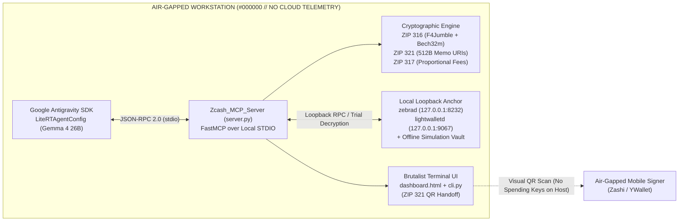

#  `NODE 07 // ZCASH MCP STANDARD LIBRARY & PROJECT AEGIS-Z`

```text
┌──────────────────────────────────────────────────────────────────────────────┐
│ [NODE 07 ONLINE] // THE PYRAMID WAKES // ZECATHON INFRASTRUCTURE & AEGIS-Z  │
│ SERVER: Zcash_MCP_Server (FastMCP stdio) // MANDATE: "DOES NOT LEAK"        │
│ AESTHETIC: #000000 BLACK // JETBRAINS MONO // #00FF41 PHOSPHOR // 26x26 ID  │
└──────────────────────────────────────────────────────────────────────────────┘
```

> **ZECATHON Track Alignment:** Infrastructure (*The Zcash MCP Standard Library*) & Accounting (*Project Aegis-Z: Autonomous Local-Only Zcash Financial Controller*)  
> **Execution Guarantee:** 100% Local Stdio / Loopback Execution (`127.0.0.1`). Zero private keys, Unified Full Viewing Keys (UFVKs), or decrypted 512-byte shielded memos ever leave the host machine.

---

## 00 // ARCHITECTURAL BLUEPRINT

The **Zcash MCP Standard Library** (`Zcash_MCP_Server`) bridges autonomous local AI agents (orchestrated via the **Google Antigravity SDK** `LiteRTAgentConfig` + `McpStdioServer`) with Zcash's core zero-knowledge cryptographic primitives and local node infrastructure (`lightwalletd` & `zebrad`).



---

## 01 // CRYPTOGRAPHIC SPECIFICATIONS IMPLEMENTED

Unlike superficial regex wrappers, [`server.py`](./server.py) implements the actual underlying mathematical and binary specifications dictated by the Zcash Improvement Proposals (ZIPs):

1. **ZIP 316 — Unified Addresses (UAs) & Unified Full Viewing Keys (UFVKs):**
   - **Bech32m Checksum (`0x2bc830a3`):** Full 5-bit/8-bit polynomial checksum verification and encoding (`u1...`, `utest1...`, `uregtest1...`, `uview1...`, `uviewtest1...`).
   - **4-Round Feistel `F4Jumble` & `F4Jumble_inv`:** Un-jumbles and jumbles raw receiver payloads using Python's native `hashlib.blake2b` with exact 16-byte ZIP 316 personalizations (`b"UA_F4Jumble_H" + bytes([i, 0, 0])` and `b"UA_F4Jumble_G" + bytes([i]) + j.to_bytes(2, "little")`).
   - **16-Byte HRP Padding & CompactSize TLV Parsing:** Verifies the trailing 16-byte zero-padded ASCII HRP, parses ascending CompactSize Type-Length-Value records (`0x00` P2PKH, `0x01` P2SH, `0x02` Sapling, `0x03` Orchard), enforces mutual exclusion of P2PKH + P2SH, and selects the protocol-mandated priority receiver (**Orchard $\rightarrow$ Sapling $\rightarrow$ Transparent**).
2. **ZIP 321 — Standardized Payment Request URIs:**
   - **Single & Multi-Recipient Payout Batches:** Constructs and parses `zcash:<addr>?amount=...&memo=...` and indexed multi-recipient URIs (`zcash:?address=...&amount=...&memo=...&address.1=...&amount.1=...&memo.1=...`).
   - **Unpadded RFC 4648 `base64url` 512-Byte Memos:** Encodes and decodes UTF-8/raw encrypted memos while strictly enforcing the 512-byte Zcash protocol ceiling and rejecting memos attached to transparent-only receivers.
3. **ZIP 317 — Proportional Transfer Fee Mechanism:**
   - Computes deterministic network fees using `marginal_fee = 5000` zatoshis and `grace_actions = 2`:
     $$\text{conventional\_fee} = 5000 \times \max(2, \text{logical\_actions})\text{ zatoshis}$$

---

## 02 // EXPOSED `@mcp.tool` STANDARD LIBRARY REGISTRY

| Tool Name | Input Parameters (Strict Type Annotations) | Description |
| :--- | :--- | :--- |
| `validate_zip316_unified_address` | `address: str` | Verifies Bech32m checksum, inverts `F4Jumble`, validates 16-byte HRP padding, extracts TLV receivers, and returns the priority receiver. |
| `generate_zip316_unified_address` | `seed_identifier: str, network: str = "mainnet", include_orchard: bool = True, include_sapling: bool = True, include_transparent_p2pkh: bool = False` | Deterministically constructs a valid ZIP 316 Unified Address via CompactSize TLV + `F4Jumble` + Bech32m. |
| `parse_zip316_ufvk` | `ufvk: str` | Parses a ZIP 316 Unified Full Viewing Key (`uview1...`), extracting Orchard (`ak`, `nk`, `rivk`), Sapling (`dfvk`), and Transparent viewing capabilities without exposing spending keys. |
| `generate_zip321_uri` | `address: str, amount_zec: str, memo_utf8: str = "", label: str = "", message: str = ""` | Generates a single-recipient ZIP 321 URI with unpadded `base64url` 512-byte encrypted memo and ZIP 317 fee estimate. |
| `construct_zip321_payout_batch` | `payments: List[Dict[str, str]]` | Builds a multi-recipient ZIP 321 batch URI for payroll/treasury settlements and computes batch fee savings. |
| `parse_zip321_uri` | `uri: str` | Parses and validates single- or multi-recipient ZIP 321 URIs and decodes all `base64url` memos back to UTF-8 and hex. |
| `estimate_zip317_fee` | `orchard_actions: int = 2, sapling_spends: int = 0, sapling_outputs: int = 0, transparent_inputs: int = 0, transparent_Outputs: int = 0` | Computes exact ZIP 317 conventional fees in zatoshis and ZEC. |
| `fetch_shielded_history` | `ufvk: str, pool_filter: str = "all", direction_filter: str = "all"` | Queries local `lightwalletd`/`zebrad` loopback (or the offline Aegis-Z vault) for decrypted Orchard & Sapling transactions. |
| `read_memo_contents` | `txid: str = ""` | Extracts 512-byte decrypted memos, invoice IDs (`INV-...`, `PAYROLL-...`, `CAPEX-...`), and Chart of Accounts mappings. |
| `execute_trial_decryption` | `start_height: int, end_height: int, ufvk: str` | Runs trial decryption across compact block ranges for Orchard (Halo 2) and Sapling commitment trees. |
| `query_lightwalletd` | `endpoint: str = "GetLightdInfo", block_height: int = 2690500` | Queries local `lightwalletd` endpoints (`GetLightdInfo`, `GetLatestBlock`, `GetTreeState`, `GetBlockRange`). |
| `query_zebrad_rpc` | `method: str = "getblockchaininfo", params: Optional[List[Any]] = None` | Calls local `zebrad` JSON-RPC methods with strict loopback verification and offline simulation fallback. |
| `reconcile_shielded_ledger` | `ufvk: str` | **Project Aegis-Z Controller:** Reconciles decrypted UFVK memos against pending corporate invoices and emits a ready-to-sign ZIP 321 batch URI. |

---

## 03 // QUICKSTART (`uv` & STANDARD PYTHON)

### Using `uv` (Recommended per ZECATHON Blueprint)
```powershell
# Synchronize dependencies from pyproject.toml
uv sync

# Run the FastMCP Server over local stdio
uv run python server.py

# Run the Brutalist Terminal CLI Demonstration
uv run python cli.py demo

# Run the Cryptographic & Protocol Unit Test Suite
uv run pytest -v
```

### Using Standard Python (`pip`)
```powershell
python -m pip install -e .[dev]

# 1. Execute the full terminal demonstration (with 26x26 pixel block identities)
python cli.py demo

# 2. Run the Google Antigravity SDK + MCP Forensic Loop (Project Aegis-Z)
python antigravity_agent.py

# 3. Run the 15-test cryptographic verification suite
python -m pytest -v
```

### Interactive Dark-Terminal Dashboard
Open [`dashboard.html`](./dashboard.html) in any local browser to inspect:
- Deterministic **26x26 pixel block identities** rendered on `<canvas width="26" height="26">`
- Decrypted Orchard (Halo 2) & Sapling 512-byte memos mapped to the Aegis-Z Chart of Accounts
- Interactive **ZIP 316 F4Jumble + Bech32m** receiver inspector
- Air-gapped **ZIP 321 Multi-Recipient Payment Request URI & QR Matrix** generator for hardware/mobile wallet signing (Zashi / YWallet)
