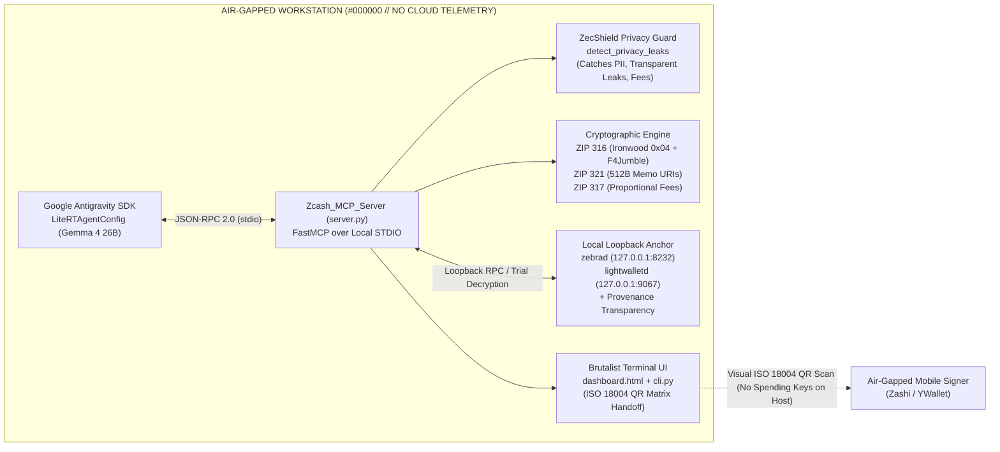

#  `ZECSHIELD // ZCASH MCP STANDARD LIBRARY & PROJECT AEGIS-Z`

```text
┌──────────────────────────────────────────────────────────────────────────────┐
│ [NODE 07 ONLINE] // THE PYRAMID WAKES // ZECATHON INFRASTRUCTURE & AEGIS-Z  │
│ SERVER: Zcash_MCP_Server (FastMCP stdio) // POSITIONING: ZECSHIELD MCP       │
│ SECURITY: FAIL-CLOSED // AIR-GAP STRICT LOOPBACK // IRONWOOD READY (0x04)    │
│ AESTHETIC: #000000 BLACK // JETBRAINS MONO // #00FF41 PHOSPHOR // 26x26 ID  │
└──────────────────────────────────────────────────────────────────────────────┘
```

> **ZECATHON $15,000 Core & Tooling Track Submission**  
> **Positioning:** AI-Native Zcash Development, Testing, and Privacy Protection ("ZecShield MCP"). Build Zcash applications with AI, test shielded transactions locally, and catch privacy mistakes before deployment.  
> **Execution Guarantee:** 100% Local Stdio / Loopback Execution (`127.0.0.1`). Zero private keys, viewing keys, or decrypted memos ever leak to cloud hosts or external endpoints.

---

## 00 // ARCHITECTURAL BLUEPRINT

The **ZecShield MCP Server** (`Zcash_MCP_Server`) bridges autonomous local AI agents (orchestrated via the **Google Antigravity SDK** `LiteRTAgentConfig` + `McpStdioServer`) with Zcash's core zero-knowledge cryptographic primitives, live local node infrastructure (`zebrad` & `lightwalletd`), and proactive privacy defense tooling.



---

## 01 // CRITICAL HACKATHON HARDENING (ZECSHIELD UPGRADE)

Addressing key expert feedback to elevate this submission into a top-tier hackathon winner:

1. **Ironwood Shielded Pool Support (July 2026 Upgrade):**
   - Implements receiver typecode `0x04` (`TYPECODE_IRONWOOD = 0x04`) alongside Orchard (`0x03`), Sapling (`0x02`), and Transparent (`0x00`/`0x01`).
   - Enforces ascending CompactSize TLV record ordering and canonical receiver priority selection:
     $$\textbf{Ironwood (0x04)} \rightarrow \textbf{Orchard (0x03)} \rightarrow \textbf{Sapling (0x02)} \rightarrow \textbf{Transparent (0x00)}$$
   - Computes ZIP 317 logical actions including `ironwood_actions`.

2. **Proactive Privacy Leak Detection (`detect_privacy_leaks`):**
   - Scans transactions, batches, and memos prior to signing or broadcasting.
   - Flags **Transparent Address Fallback** destroying zero-knowledge guarantees.
   - Detects cleartext **Personal Identifiable Information (PII)** in memos (emails, IPv4 addresses, phone numbers, corporate identity strings).
   - Detects **Amount Precision Fingerprinting** (odd fractional decimals correlatable with off-chain merchant totals).
   - Detects **Fee Fingerprinting** (deviations from ZIP 317 marginal fee multiples).
   - Emits a standardized `0-100` privacy score and `is_safe_to_broadcast` gate.

3. **Strict Fail-Closed Security (Zero Silent Defaults):**
   - Prohibits silent substitution of default treasury addresses in payment requests (`generate_zip321_uri` strictly requires explicit destination address).
   - Prohibits silent substitution of demonstration viewing keys (`parse_zip316_ufvk` requires explicit input or `use_demo_fixture=True`).
   - Rejects encrypted memos attached to transparent-only receivers.

4. **AI Host Leak Prevention & Memo Redaction:**
   - Redacts sensitive 512-byte memo payloads with `[REDACTED_FOR_AI_PRIVACY // HASH: ...]` when queried by AI hosts (`fetch_shielded_history`, `read_memo_contents`), preventing confidential organizational data from leaking into LLM context logs.

5. **Honest Data Provenance & Live Node Diagnostics:**
   - Every RPC and query response explicitly tags provenance: `PROVENANCE: LIVE_NODE_RPC` (when connected to real `zebrad`/`zcashd` on `127.0.0.1:8232`) vs `PROVENANCE: DEMO_FIXTURE` (offline deterministic cryptographic vault).
   - Includes `live_node_client.py` for live loopback testing and regtest verification.

6. **Independent Standards Reference Vector Test Suite:**
   - 35 passing tests including BIP 350 Bech32m canonical vectors, RFC 4648 unpadded base64url memo vectors, ZIP 317 proportional fee vectors, and F4Jumble Feistel invertibility bounds.

---

## 02 // EXPOSED `@mcp.tool` STANDARD LIBRARY REGISTRY

| Tool Name | Input Parameters | Description |
| :--- | :--- | :--- |
| `detect_privacy_leaks` | `address: str, amount_zec: str, memo_utf8: str, fee_zatoshis: Optional[int], recipients: Optional[List]` | **ZecShield Security Guard:** Scans for transparent fallback, cleartext PII in memos, amount precision fingerprinting, fee anomalies, and address reuse. |
| `validate_zip316_unified_address` | `address: str` | Verifies Bech32m checksum (`0x2bc830a3`), inverts `F4Jumble`, validates 16-byte HRP padding, extracts TLVs, and returns Ironwood/Orchard/Sapling priority. |
| `generate_zip316_unified_address` | `seed_identifier: str, network: str = "mainnet", include_ironwood: bool = False, include_orchard: bool = True, include_sapling: bool = True, include_transparent_p2pkh: bool = True` | Deterministically constructs a valid ZIP 316 Unified Address with ascending CompactSize TLVs + `F4Jumble` + Bech32m. |
| `parse_zip316_ufvk` | `ufvk: str, use_demo_fixture: bool = False` | Parses a ZIP 316 Unified Full Viewing Key (`uview1...`), isolating Ironwood/Orchard/Sapling viewing keys without spending keys. Fails closed if input is missing. |
| `generate_zip321_uri` | `address: str, amount_zec: str, memo_utf8: str = "", label: str = "", message: str = "", require_shielded: bool = False` | Generates a single-recipient ZIP 321 URI with unpadded `base64url` memo and ZIP 317 fee calculation. Prohibits silent recipient substitution. |
| `construct_zip321_payout_batch` | `payments: List[Dict[str, str]]` | Builds a multi-recipient ZIP 321 batch URI for payroll/treasury settlements and computes batch fee savings. |
| `parse_zip321_uri` | `uri: str` | Parses and validates single- or multi-recipient ZIP 321 URIs and decodes all `base64url` memos back to UTF-8 and hex. |
| `estimate_zip317_fee` | `ironwood_actions: int = 0, orchard_actions: int = 2, sapling_spends: int = 0, sapling_outputs: int = 0, transparent_inputs: int = 0, transparent_outputs: int = 0` | Computes exact ZIP 317 conventional fees in zatoshis and ZEC. |
| `render_zip321_qr` | `uri: str, output_path: str = "assets/latest_zip321_qr.svg"` | Generates genuine ISO/IEC 18004 Reed-Solomon QR codes scannable by mobile shielded signers (Zashi, YWallet). |
| `fetch_shielded_history` | `ufvk: str, pool_filter: str = "all", direction_filter: str = "all", redact_sensitive_memos: bool = True` | Queries local `lightwalletd`/`zebrad` loopback for decrypted transactions, with AI memo redaction active by default. |
| `read_memo_contents` | `txid: str = "", redact_for_ai: bool = False` | Extracts 512-byte decrypted memos, invoice IDs, and Chart of Accounts mappings. |
| `execute_trial_decryption` | `start_height: int, end_height: int, ufvk: str` | Runs trial decryption across compact block ranges for Orchard (Halo 2) and Sapling commitment trees. |
| `query_lightwalletd` | `endpoint: str = "GetLightdInfo", block_height: int = 2690500` | Queries local `lightwalletd` endpoints with explicit data provenance tracking (`LIVE_NODE_RPC` vs `DEMO_FIXTURE`). |
| `query_zebrad_rpc` | `method: str = "getblockchaininfo", params: Optional[List[Any]] = None` | Calls local `zebrad` JSON-RPC methods with loopback security and provenance disclosure. |
| `reconcile_shielded_ledger` | `ufvk: str` | **Project Aegis-Z Controller:** Reconciles decrypted UFVK memos against pending corporate obligations and emits a ready-to-sign ZIP 321 batch URI. |

---

## 03 // QUICKSTART & VERIFICATION

### 1. Run the Complete Verification Suite
```powershell
# Run the 3-test hackathon verification suite over the FastMCP client protocol
python run_verification_tests.py
```

### 2. Run All 35 Unit & Reference Vector Tests
```powershell
python -m pytest -v
```

### 3. Run the Brutalist Terminal CLI Demo
```powershell
# Full 6-stage demo (Aegis-Z accounting + ZecShield privacy audit)
python cli.py demo

# Audit an individual payment request for privacy leaks
python cli.py leak-audit --address "t1VpYecBW4UudbGcy4ufh61eWxQCoFaUrPs" --memo "Payment to alice@cypherpunk.org"
```

### 4. Check Local Node Connectivity & Provenance
```powershell
python live_node_client.py
```

### 5. Interactive Dark-Terminal Dashboard
Open [`dashboard.html`](./dashboard.html) in any local browser to inspect:
- Deterministic **26x26 pixel block identities** rendered on `<canvas width="26" height="26">`
- Decrypted Orchard (Halo 2) & Sapling 512-byte memos mapped to the Aegis-Z Chart of Accounts
- Interactive **ZIP 316 F4Jumble + Bech32m** receiver inspector
- Air-gapped **ZIP 321 Multi-Recipient Payment Request URI & ISO 18004 QR Matrix** generator with mobile scanner polarity toggle for Zashi / YWallet.
