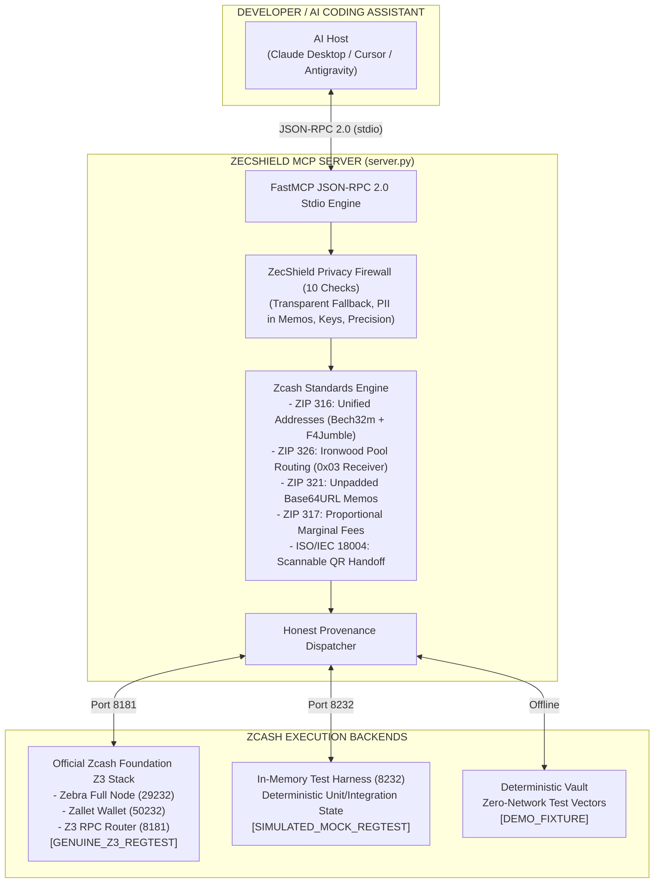

#  `ZECSHIELD MCP // AI-NATIVE ZCASH DEV & PRIVACY FIREWALL`

```text
┌──────────────────────────────────────────────────────────────────────────────┐
│ [NODE 07 ONLINE] // ZECATHON 2026 // CORE & TOOLING TRACK ($15,000)          │
│ TAGLINE: Build on Zcash with AI. Test everything. Leak nothing unnecessarily.│
│ STANDARDS: ZIP 316 // ZIP 326 (IRONWOOD) // ZIP 321 // ZIP 317 // ISO 18004 │
│ FIREWALL: 10 PRE-BROADCAST PRIVACY & SECURITY CHECKS // FAIL-CLOSED POLICY   │
│ VERIFICATION: 52 / 52 TESTS PASSING (100% PASS RATE) // AIR-GAPPED LOOPBACK │
│ AESTHETIC: #000000 BLACK // JETBRAINS MONO // #00FF41 PHOSPHOR // 26x26 ID  │
└──────────────────────────────────────────────────────────────────────────────┘
```

> **ZECATHON 2026 Submission** | **Track:** Core & Tooling ($15,000)  
> **Positioning:** AI-Native Zcash Developer Infrastructure & Privacy Testing Toolkit.  
> **Differentiation:** Other tools help AI agents *spend* ZEC. ZecShield MCP gives AI agents and developers the infrastructure to *build, test, inspect, and protect* Zcash applications from catastrophic privacy leaks.

---

## Documentation Index

- [Architecture & Technical Design](docs/ARCHITECTURE.md)
- [Zcash Foundation Z3 Integration Guide](docs/INTEGRATION_GUIDE.md)
- [Privacy Firewall & Agent Security Model](docs/SECURITY_MODEL.md)
- [Zcash Protocol Compliance (ZIP 316, 321, 317, 326)](docs/PROTOCOL_COMPLIANCE.md)
- [Multi-Layer Testing & Verification Guide](docs/TESTING.md)
- [2-3 Minute Judge Demonstration Script](docs/DEMO_SCRIPT.md)
- [Hackathon Submission Summary](docs/HACKATHON_SUBMISSION.md)
- [Known Limitations & Future Scope](docs/KNOWN_LIMITATIONS.md)
- [Technical Audit & Remediation Log](docs/TECHNICAL_AUDIT.md)

---

## 00 // Architectural Blueprint



---

## 01 // The Signature Innovation: ZecShield Privacy Firewall

AI coding assistants frequently generate code that introduces subtle, irreversible privacy breaks:
1. **Transparent Address Fallbacks:** Defaulting to `t1...` addresses strips all zero-knowledge privacy guarantees.
2. **Cleartext PII in Memos:** Attaching unhashed emails, IPs, or names in on-chain memos creates permanent off-chain identity links for any viewing key auditor.
3. **Exposed Spending Keys:** Accidentally hardcoding test spending keys in scripts exposes all funds to theft.
4. **Prompt Injections:** Malicious memos can hijack downstream autonomous LLM agents.
5. **Sub-Zatoshi Precision Bugs:** Specifying fractions of a zatoshi causes floating-point rounding errors.

The **ZecShield Privacy Firewall** inspects transactions pre-broadcast across 10 deterministic checks:
- `CHECK 01: TRANSPARENT_EXPOSURE` - Rejects transparent recipients (`t1`, `t3`).
- `CHECK 02: PRIVACY_DOWNGRADE` - Blocks silent shielded &rarr; transparent fallbacks.
- `CHECK 03: SENSITIVE_MEMO_PII` - Scans for cleartext emails, IPv4/IPv6, phone numbers, SSNs.
- `CHECK 04: VIEWING_KEY_EXPOSURE` - Detects viewing keys (`uview1...`, `zxviews1...`) in memos.
- `CHECK 05: WALLET_SECRET_PROTECTION` - Flags spending keys (`secret-extended-key...`) and seed phrases.
- `CHECK 06: UNSAFE_RPC_TARGET` - Rejects cleartext remote RPC destinations.
- `CHECK 07: ADDRESS_RECEIVER_VALIDATION` - Validates ZIP 316 structure and pool compatibility.
- `CHECK 08: AMOUNT_SATOSHI_PRECISION` - Enforces integer zatoshis (&le; 8 decimals) and max supply bounds.
- `CHECK 09: TRANSACTION_POLICY_ENFORCEMENT` - Enforces single-use cryptographic authorization tickets for state mutations.
- `CHECK 10: METADATA_CORRELATION_LEAK` - Detects persistent invoice IDs and UUIDs.

---

## 02 // Cryptographic Honesty & Z3 Integration

ZecShield MCP enforces **absolute cryptographic honesty**. We never fabricate synthetic blocks and present them as genuine Zebra/Zallet consensus proofs.

Every response returned by ZecShield declares its exact provenance:
- **`GENUINE_Z3_REGTEST`**: Verified connection to the official Zcash Foundation Z3 Docker stack (`zebrad` at 29232, `zallet` at 50232, router at 8181). Authentic Halo 2 and Groth16 proofs.
- **`GENUINE_ZEBRA_NODE`**: Verified connection to an active Zebra consensus full node.
- **`SIMULATED_MOCK_REGTEST`**: In-memory Python test harness on `127.0.0.1:8232` used for offline test suites when Docker is not installed.
- **`DEMO_FIXTURE`**: Deterministic offline cryptographic test vector vault.

### Launching the Genuine Z3 Stack
```bash
# 1. Start Zebra, Zallet, and the Z3 RPC router in the background
docker compose up -d

# 2. Check infrastructure readiness
python live_node_client.py --check-infra

# 3. Execute regtest workflow
python live_node_client.py --regtest-demo
```

---

## 03 // Reusable GitHub Action & CI Workflow

Developers can add automated Zcash privacy linting to their own repositories with our GitHub Action (`action.yml`):

```yaml
# .github/workflows/zecshield-audit.yml
name: ZecShield Privacy Audit
on: [push, pull_request]

jobs:
  privacy-check:
    runs-on: ubuntu-latest
    steps:
      - uses: actions/checkout@v4
      - uses: ademikelz19-hub/zcash-mcp-server@main
        with:
          path: "."
          fail-on-critical: "true"
```

Or run directly via CLI:
```bash
# Fails CI on critical violations (exit code 1)
python cli.py audit-ci . --fail-on-critical --json-out audit-report.json

# Test sample fixtures:
python cli.py audit-ci fixtures/vulnerable_app  # Exits 1 (5 critical leaks)
python cli.py audit-ci fixtures/fixed_app       # Exits 0 (0 leaks)
```

---

## 04 // Exposed MCP Tool Standard Library (16 Tools)

### Developer Utilities
- `validate_zip316_unified_address`: Bech32m checksum (`0x2bc830a3`), 4-round BLAKE2b `F4Jumble`, TLV CompactSize parsing, and priority fallback (`Orchard -> Sapling -> Transparent`).
- `generate_zip316_unified_address`: Constructs valid ZIP 316 Unified Addresses.
- `parse_zip316_ufvk`: Parses Unified Full Viewing Keys (`uview1...`) safely without exposing spending keys.
- `generate_zip321_uri`: Constructs standardized payment URIs with unpadded RFC 4648 Base64URL memos.
- `parse_zip321_uri`: Decodes single- and multi-recipient payment URIs and memos.
- `construct_zip321_payout_batch`: Multi-recipient payout batch URI generator with fee calculations.
- `estimate_zip317_fee`: Calculates ZIP 317 proportional conventional fees (`5000 zatoshis * max(2, actions)`).
- `route_shielded_pool`: ZIP 326 pool routing (routes to Ironwood/Orchard/Sapling while reusing receiver `0x03`).
- `render_zip321_qr`: ISO/IEC 18004 Reed-Solomon scannable QR code generator for mobile wallets (Zashi, YWallet).

### Privacy & Intent-Bound Security
- `audit_transaction_privacy`: Full 10-check ZecShield Privacy Firewall audit with structured JSON results and Decision Triad (`PASS / WARN / BLOCK`).
- `request_transaction_intent`: Issues a cryptographically bound single-use Transaction Authorization Ticket (`(recipient, zatoshis, fee, memo_hash) -> SHA-256 digest`) with TTL expiry.
- `execute_authorized_broadcast`: Consumes an authorization ticket, strictly validates parameter binding (anti-tampering), and enforces anti-replay protection.
- `detect_privacy_leaks`: Pre-broadcast vulnerability scanner.
- `explain_privacy_violation`: Detailed catalog lookup for finding IDs with remediation code examples.
- `sanitize_ai_memo`: Scrubs memos for model safety (`[REDACTED_BY_ZECSHIELD_FOR_AI_PRIVACY]`).

### Infrastructure
- `check_z3_infrastructure`: Probes Docker, WSL2, and port availability for Zebra, Zallet, and the Z3 router.
- `query_zebrad_rpc`: JSON-RPC query client with honest provenance tagging.
- `query_lightwalletd`: Probes local `lightwalletd` loopback service.
- `fetch_shielded_history`: Queries shielded history with zero-correlation AI memo redaction.
- `reconcile_shielded_ledger`: Reconciles confirmed balances and charts of accounts.

---

## 05 // Independent Multi-Layer Verification (52 / 52 Passing)

```bash
# Run the complete test suite
python -m pytest tests/ -v
```

```text
============================= test session starts =============================
collected 52 items

tests/test_privacy_firewall.py::test_firewall_permits_clean_shielded_payment PASSED [  1%]
tests/test_privacy_firewall.py::test_firewall_blocks_transparent_address_exposure PASSED [  3%]
tests/test_privacy_firewall.py::test_firewall_detects_pii_emails_and_ips_in_memos PASSED [  5%]
tests/test_privacy_firewall.py::test_firewall_blocks_spending_key_leakage PASSED [  7%]
tests/test_privacy_firewall.py::test_firewall_detects_bip39_seed_phrases PASSED [  9%]
tests/test_privacy_firewall.py::test_firewall_neutralizes_prompt_injection_attempts PASSED [ 11%]
tests/test_privacy_firewall.py::test_firewall_detects_viewing_key_in_memo PASSED [ 13%]
tests/test_privacy_firewall.py::test_firewall_blocks_sub_zatoshi_and_invalid_amounts PASSED [ 15%]
tests/test_privacy_firewall.py::test_firewall_enforces_loopback_rpc_policy PASSED [ 17%]
tests/test_privacy_firewall.py::test_firewall_enforces_human_approval_boundary_for_state_changes PASSED [ 19%]
tests/test_privacy_firewall.py::test_explain_privacy_violation_catalog PASSED [ 21%]
tests/test_privacy_firewall.py::test_sanitize_ai_memo_guarantee PASSED   [ 23%]
tests/test_privacy_firewall.py::test_intent_ticket_lifecycle_and_tampering_prevention PASSED [ 25%]
tests/test_privacy_firewall.py::test_intent_ticket_expiration_protection PASSED [ 26%]
tests/test_privacy_firewall.py::test_intent_ticket_fails_closed_on_firewall_violation PASSED [ 28%]
tests/test_privacy_firewall.py::test_firewall_decision_triad_pass_warn_block PASSED [ 30%]
tests/test_privacy_firewall.py::test_state_mutation_via_intent_ticket_in_firewall_audit PASSED [ 32%]
tests/test_reference_vectors.py::test_bip350_valid_bech32m_reference_vectors PASSED [ 34%]
tests/test_reference_vectors.py::test_bip350_invalid_bech32m_reference_vectors PASSED [ 36%]
tests/test_reference_vectors.py::test_bech32m_arbitrary_payload_roundtrip PASSED [ 38%]
tests/test_reference_vectors.py::test_zip321_rfc4648_unpadded_base64url_vectors PASSED [ 40%]
tests/test_reference_vectors.py::test_zip321_uri_parsing_reference_vectors PASSED [ 42%]
tests/test_reference_vectors.py::test_zip317_fee_calculation_against_reference_vectors PASSED [ 44%]
tests/test_reference_vectors.py::test_f4jumble_invertibility_across_standard_buffer_sizes PASSED [ 46%]
tests/test_reference_vectors.py::test_f4jumble_strictly_enforces_minimum_length_48_bytes PASSED [ 48%]
tests/test_reference_vectors.py::test_compactsize_canonical_boundaries PASSED [ 50%]
tests/test_server.py::test_fastmcp_server_initialization PASSED          [ 51%]
tests/test_server.py::test_f4jumble_feistel_roundtrip PASSED             [ 53%]
tests/test_server.py::test_f4jumble_rejects_short_messages PASSED        [ 55%]
tests/test_server.py::test_compact_size_roundtrip PASSED                 [ 57%]
tests/test_server.py::test_zip316_unified_address_generation_and_validation PASSED [ 59%]
tests/test_server.py::test_zip316_rejects_both_p2pkh_and_p2sh PASSED     [ 61%]
tests/test_server.py::test_zip316_rejects_transparent_only_ua PASSED     [ 63%]
tests/test_server.py::test_zip316_ufvk_parsing PASSED                    [ 65%]
tests/test_server.py::test_zip321_single_recipient_and_memo_roundtrip PASSED [ 67%]
tests/test_server.py::test_zip321_rejects_oversized_512_byte_memo PASSED [ 69%]
tests/test_server.py::test_zip321_rejects_memo_on_transparent_address PASSED [ 71%]
tests/test_server.py::test_zip321_multi_recipient_payout_batch PASSED    [ 73%]
tests/test_server.py::test_zip317_proportional_fee_mechanism PASSED      [ 75%]
tests/test_server.py::test_airgap_loopback_policy_enforcement PASSED     [ 76%]
tests/test_server.py::test_shielded_history_trial_decryption_and_aegis_reconciliation PASSED [ 78%]
tests/test_server.py::test_lightwalletd_and_zebrad_queries PASSED        [ 80%]
tests/test_server.py::test_user_prompt_1_address_generation_and_priority_fallback PASSED [ 82%]
tests/test_server.py::test_user_prompt_2_parse_ufvk_viewing_key PASSED   [ 84%]
tests/test_server.py::test_user_prompt_3_generate_50_zec_uri PASSED      [ 86%]
tests/test_server.py::test_fastmcp_client_protocol_execution PASSED      [ 88%]
tests/test_server.py::test_render_zip321_iso18004_qr PASSED              [ 90%]
tests/test_server.py::test_fail_closed_missing_address_in_zip321 PASSED  [ 92%]
tests/test_server.py::test_fail_closed_missing_ufvk_without_explicit_fixture PASSED [ 94%]
tests/test_server.py::test_zip326_ironwood_pool_routing_and_orchard_receiver_reuse PASSED [ 96%]
tests/test_server.py::test_zecshield_privacy_leak_detector PASSED        [ 98%]
tests/test_server.py::test_ai_memo_redaction_for_host_safety PASSED      [100%]

============================= 52 passed in 17.03s =============================
```

---

## 06 // Quickstart for Judges

### 1. Installation
```bash
git clone https://github.com/ademikelz19-hub/zcash-mcp-server.git
cd zcash-mcp-server
pip install -e .
pip install pytest pytest-asyncio httpx segno
```

### 2. Run Multi-Layer Verification
```bash
python -m pytest tests/ -v
```

### 3. Open Brutalist Dashboard
Open `dashboard.html` in any browser to interact with the Privacy Firewall Lab, inspect ZIP 316 addresses, and generate ISO/IEC 18004 QR codes.

### 4. Configure in Claude Desktop / Cursor
Add to `claude_desktop_config.json`:
```json
{
  "mcpServers": {
    "zecshield": {
      "command": "python",
      "args": ["-u", "/path/to/server.py"]
    }
  }
}
```

---

## License

MIT License &copy; 2026 ZecShield Team &bull; Engineered for the zkSNARKs ZECATHON.
